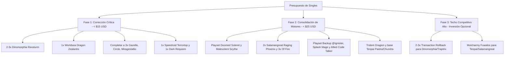

# 📋 Reporte Estratégico de Singles y Soporte Competitivo por Decks
**Proyecto:** `personal-yugioh-deckbuilder`  
**Fecha de Análisis:** Octubre 2026  
**Entorno de Referencia:** Yu-Gi-Oh! TCG Actual (Post-Banlist Nuclear del 19 de Octubre de 2026 y Listas de Torneo YCS/Regionales Recientes)  
**Inventario Cruzado:** Colección del Usuario (~3,114 cartas registradas)

---

## 🧭 Resumen Ejecutivo & Estado del Formato

La reciente actualización de la Forbidden & Limited List (encabezada por el histórico ajuste del **19 de octubre de 2026** donde se prohibieron 34 cartas a la vez, incluyendo staples de consistencia omnipresentes como *Called by the Grave*, *Crossout Designator* y *Triple Tactics Talent*, sumado a los límites y prohibiciones previas como *Apollousa, Bow of the Goddess*, *Beatrice, Lady of the Eternal*, la limitación de *Sangen Summoning* a 1 y *Branded Fusion* a 1) ha provocado una rotación natural hacia **arquetipos con alta consistencia nativa, motores sinérgicos dedicados y handtraps de nueva generación**.

Paralelamente, Konami ha liberado cartas de soporte de arquetipos emblemáticos en expansiones recientes como **Chaos Origins (CORI)** (*Phantom Knights*), **Alliance Insight (ALIN)** (*@Ignister / Code Talker*), **Immortal Phoenix (IMPH)** (*Salamangreat*), **Legacy of Destruction (LEDE)** (*Lightsworn* y el motor tri-tipo *Ragnaraika* para *Insectos/Reptiles*), además de reimpresiones masivas en *Mega Tins* y colecciones de rareza (*Rarity Collection 1 & 2*).

### 🔍 Hallazgo Clave en tu Colección Física
Al cruzar tus tablas de base de datos (`yg_user_cards`), detectamos que **ya posees piezas clave de muy alto valor** que muchos jugadores deben adquirir de cero:
- ✅ **1x S:P Little Knight** (En *Deckbox Plástica 25th*) — ¡No necesitas comprarla!
- ✅ **1x Promethean Princess, Bestower of Flames** (En *Deckbox Plástica 25th*) — Pilar para *Salamangreat* y *Fire King*.
- ✅ **2x Super Starslayer TY-PHON - Sky Crisis** — Cobertura completa anti-bosses.
- ✅ **3x Accesscode Talker** (Secret Rare y Comunes) — Cobertura total de OTK Cyberse.
- ✅ **Play-sets completos de Handtraps básicas:** 7x *Ash Blossom*, 14x *Infinite Impermanence*, 6x *Effect Veiler*, 3x *Droll & Lock Bird*, 3x *Ghost Mourner*, 2x *Ghost Belle*, 2x *Nibiru*, 4x *Super Polymerization*.

A continuación, se desglosan las cartas singles recomendadas a buscar por deck, organizadas en los **5 niveles estrictos de priorización**.

---

## 🗂️ Niveles de Clasificación de Singles

1. **🔴 Prioritarias (Must-Have / Eje Competitivo):** Piezas esenciales que definen la condición de victoria o el combo primario del deck. Sin ellas, el deck no rinde al nivel competitivo actual.
2. **🟢 Low-Cost Atractivas (Budget High-Value / < $3 USD):** Singles económicas (comunes, súper o reimpresiones) con un impacto desproporcionadamente alto en consistencia, resiliencia o extensión.
3. **🟡 High-Cost Atractivas ($10 - $40+ USD):** Inversiones competitivas de alto impacto para torneos de alto nivel que potencian drásticamente el techo del mazo.
4. **⚪ Low-Cost Descartables (Trampas de Bulk):** Cartas del arquetipo baratas pero lentas, situacionales o "win-more" que hoy en día restan competitividad.
5. **⛔ High-Cost Descartables (Trampas de Dinero / Banlist):** Cartas costosas afectadas por la banlist reciente o con precios inflados por coleccionismo que no aportan al rendimiento de juego.

---

## 1. ⚔️ The Phantom Knights / Phantom Adventure
*Estado:* Refuerzo masivo en **Chaos Origins (CORI)** + liberación de *Speedroid Terrortop* a 3.

| Nivel | Carta | Rol / Justificación | Expansión Clave | Costo Est. (USD) |
| :--- | :--- | :--- | :--- | :--- |
| **🔴 Prioritaria** | **The Phantom Knights of Doomed Soleret** (x3) | Starter de 1 carta. Se invoca gratis si no controlas monstruos y setea directo del deck cualquier Magia/Trampa PK. En GY modula Rangos/Niveles +1. | *Chaos Origins (CORI)* | $1.00 - $2.50 |
| **🔴 Prioritaria** | **The Phantom Knights of Malevolent Scythe** (x1-2) | Rango 3 Xyz. Desacopla 1 para invocar cualquier PK del deck. Al invocar un Xyz Dragon busca cualquier Rank-Up-Magic. Flota al ser destruido. | *Chaos Origins (CORI)* | $1.50 - $3.00 |
| **🔴 Prioritaria** | **Dark Requiem Xyz Dragon** (x1) | Boss monster definitivo: 3 negaciones de efectos de monstruos + destruye y revive un monstruo Xyz de tu GY. | *Legendary Dragon / Rarity* | $1.00 - $2.00 |
| **🔴 Prioritaria** | **Speedroid Terrortop** (x1 más) | Tienes 2 copias en el deck. Ya es **ilimitada a 3**. Es el mejor Rank 3 sin gastar la Normal Summon del juego. | *Rarity Collection 2* | $0.50 - $1.00 |
| **🔴 Prioritaria** | **Leviair the Sea Dragon** (x1) | Recicla monstruos PK desterrados (*Torn Scales*, *Silent Boots*, *Ancient Cloak*) para extender combos. | *Rarity Collection 2 / BLC1* | $0.50 - $1.00 |
| **🔴 Prioritaria** | **The Phantom Knights' Rank-Up-Magic Launch** (x1) | Magia de Rango Rápido para subir a *Dark Requiem* o *Red-Eyes Dark Dragoon / D/D/D Kali Yuga* en el turno rival. | *LED8 / OP15* | $0.50 - $1.25 |
| **🟢 Low-Cost Atractiva** | **The Phantom Knights of Decayed Cloak** (x1-2) | Nombre adicional Lv3, extiende y asegura búsqueda sin gastar recursos clave. | *Chaos Origins (CORI)* | $0.50 - $1.00 |
| **🟢 Low-Cost Atractiva** | **The Phantom Knights of Umbrage Veil** (x1) | Trampa que se activa el turno en que se setea si tienes PK en GY. Provee disrupción sorpresa y un cuerpo en campo. | *Chaos Origins (CORI)* | $0.50 - $1.00 |
| **🟢 Low-Cost Atractiva** | **Downerd Magician** (x1) | Trampolín de material Xyz sobre cualquier Rango 3 o 4 para bajar un Zeus de 4 materiales. | *Rarity Collection 1* | $0.50 - $0.75 |
| **🟢 Low-Cost Atractiva** | **Divine Arsenal AA-ZEUS - Sky Thunder** (x1) | Limpiador universal de tableros si el ataque de Break Sword o Raider's Knight conecta. | *Rarity Collection 1* | $2.50 - $4.00 |
| **🟡 High-Cost Atractiva** | **Fiendsmith Engine (Engraver, Lacrima, Tract, Sequence)** | Paquete de Nivel 6 / Enlace de Luz Demonio que se inicia con *Tour Guide* o cualquier 2 cuerpos para dar omni-negates antes de tus jugadas PK. | *The Infinite Forbidden (INFO)* | $30 - $70 (Pack) |
| **🟡 High-Cost Atractiva** | **Triple Tactics Thrust** (x2-3) | Te permite buscar *Rite of Aramesir*, *Rank-Up-Magic* o *Fog Blade* si el oponente activa una handtrap en tu turno. | *Rarity Collection 2* | $12.00 - $18.00 |
| **⚪ Low-Cost Descartable** | *The Phantom Knights of Cursed Javelin / Tomb Shield / Lost Vampbrace* | Cartas viejas del arquetipo que no aportan a la velocidad actual del juego. | Varios | $0.25 |
| **⛔ High-Cost Descartable** | *Apollousa, Bow of the Goddess* | **PROHIBIDA** en la banlist reciente de TCG. No comprar. | Banlist TCG | N/A |
| **⛔ High-Cost Descartable** | *Called by the Grave* | **PROHIBIDA** en el banlist masivo de octubre de 2026. No invertir. | Banlist TCG | N/A |

---

## 2. 🦁 Salamangreat
*Estado:* *Gazelle*, *Miragestallio* y *Circle* liberados a 3 en TCG + soporte de *Soulburning Volcano* y **Immortal Phoenix (IMPH)**.

| Nivel | Carta | Rol / Justificación | Expansión Clave | Costo Est. (USD) |
| :--- | :--- | :--- | :--- | :--- |
| **🔴 Prioritaria** | **Salamangreat Raging Phoenix** (x2) | Link-4 indispensable. Al hacer Reincarnation Link busca CUALQUIER carta Salamangreat del deck. Se revive con boost de ATK si un monstruo FUEGO es destruido. Hace combo mortal con Promethean Princess. | *Soulburning Volcano / Mega Tin* | $3.50 - $5.50 |
| **🔴 Prioritaria** | **Salamangreat of Fire** (x3) | Starter de 1 carta. Al ser invocado busca cualquier Salamangreat de Nivel 4 o menor del deck. | *Soulburning Volcano / Mega Tin* | $1.00 - $2.00 |
| **🔴 Prioritaria** | **Salamangreat Gazelle** (x2 más) | En tu deck solo tienes 1. **Está ilimitada a 3**. Es el corazón del mazo para enviar *Roar*, *Rage* o *Spinny* al GY. | *Structure / MP20* | $0.50 |
| **🔴 Prioritaria** | **Salamangreat Miragestallio** (x1 más) | Tienes 1 en deck; ahora legal a 3. Invoca directo del mazo desacoplando 1 material. | *Soulburning Volcano* | $0.25 - $0.50 |
| **🔴 Prioritaria** | **Salamangreat Circle** (x1 más) | Tienes 2 en deck; legal a 3. Buscador rápido que además da inmunidad a efectos de monstruos. | *Structure Deck* | $0.50 |
| **🔴 Prioritaria** | **Worldsea Dragon Zealantis** (x1) | Link-4 de Agua/Dragón. Destierra todo el campo y lo re-invoca; gracias al candado de *Promethean Princess* en tu cementerio, los monstruos del rival que no sean de Fuego NO pueden regresar. Limpia el campo rival sin destruir. | *Darkwing Blast / MP23* | $1.00 - $1.50 |
| **🟢 Low-Cost Atractiva** | **Salamangreat Markhor** (x2) | *Immortal Phoenix (IMPH)*. Starter/extensor Lv4. Busca o recupera Magia/Trampa; si se usa para Link-3+ invoca un Cyberse de FUEGO directo del deck. | *Immortal Phoenix (IMPH)* | $0.75 - $1.50 |
| **🟢 Low-Cost Atractiva** | **Salamangreat Bastella** (x1-2) | *Immortal Phoenix (IMPH)*. Tuner Lv3 que se auto-invoca. Desde el GY, al invocar un Link-3+ de Fuego, se destierra y setea *Roar* o *Rage* directo del deck (esquiva a *Droll*). | *Immortal Phoenix (IMPH)* | $0.50 - $1.00 |
| **🟢 Low-Cost Atractiva** | **Salamangreat Weasel** (x1) | Se auto-invoca si tienes 2+ Salamangreat en GY y hace robar 1 carta al usarse para Link de Fuego. | *Soulburning Volcano* | $0.25 - $0.50 |
| **🟢 Low-Cost Atractiva** | **Code of Soul** (x1) | Monstruo Cyberse que permite realizar Link Summon durante el turno del oponente (activando efectos sorpresa de Promethean o Raging Phoenix). | *Legacy of Destruction (LEDE)* | $0.50 - $1.00 |
| **🟢 Low-Cost Atractiva** | **Salamangreat Shrine** (x1) | Campo alternativo que protege a tus monstruos de efectos de monstruos de FUEGO del rival y cicla manos muertas. | *Immortal Phoenix (IMPH)* | $0.50 |
| **🟡 High-Cost Atractiva** | **Mulcharmy Fuwalos** (x3) | La handtrap meta por excelencia post-banlist: roba cada vez que el rival invoque del Deck o Extra Deck. | *Rage of the Abyss (ROTA)* | $25.00 - $35.00 |
| **⚪ Low-Cost Descartable** | *Salamangreat Emerald Eagle / Falco / Fennec / Wolvie / Burning Shell* | Cartas que tienes en el deck actual pero que en el meta competitivo moderno generan manos muertas. Es mejor reemplazarlas por las de *IMPH* y handtraps. | Colección Propia | $0.00 |
| **⛔ High-Cost Descartable** | *Snake-Eye Engine (Wanted / Diabellstar / Ash)* | Recibió duros golpes en las últimas banlists (*Snake-Eye Ash* limitada/prohibida, *Wanted* a 1). No vale la pena el alto costo para jugar Salamangreat híbrido. | Varios | Evitar |

---

## 3. 🌐 @Ignister
*Estado:* Nuevo soporte estelar en **Alliance Insight (ALIN)** fusionando la temática @Ignister con *Code Talker*.

| Nivel | Carta | Rol / Justificación | Expansión Clave | Costo Est. (USD) |
| :--- | :--- | :--- | :--- | :--- |
| **🔴 Prioritaria** | **Splash Mage** (x2) | Link-2 fundamental en cualquier baraja Cyberse: revive cualquier Cyberse del GY en posición de defensa. | *Rarity Collection 1 / ETCO* | $0.50 - $0.75 |
| **🔴 Prioritaria** | **Allied Code Talker @Ignister** (x1) | Link-5 masivo de *Alliance Insight*. Al caer revive todos los Cyberse con 2300 ATK que puedas en zonas a las que apunte. Como efecto rápido tributa un Link para negar y desterrar cualquier carta rival. | *Alliance Insight (ALIN)* | $2.50 - $4.00 |
| **🔴 Prioritaria** | **Backup @Ignister** (x2-3) | *Alliance Insight*. Lv3 Tuner. Si controlas un Cyberse de Extra Deck se invoca especial de mano y busca cualquier Cyberse de OSCURIDAD del mazo. | *Alliance Insight (ALIN)* | $0.75 - $1.50 |
| **🔴 Prioritaria** | **Wizard @Ignister** (x1-2) | *Alliance Insight*. Lv4. Se auto-invoca y revive un Cyberse de OSCURIDAD del cementerio para seguir trepando enlaces. | *Alliance Insight (ALIN)* | $0.50 - $1.00 |
| **🔴 Prioritaria** | **Decode Talker Heatsoul** (x1) | Link-3 de fuego. Roba 1 carta en tu turno y 1 en el turno del oponente pagando 1000 LP. Generador masivo de handtraps. | *Structure / GFP2* | $0.50 |
| **🔴 Prioritaria** | **Transcode Talker** (x1) | Link-3 que revive un Link-3 o menor para cerrar jugadas hacia *Accesscode Talker* o *Allied Code Talker*. | *Structure / Rarity* | $0.50 |
| **🟢 Low-Cost Atractiva** | **Cyberse Desavewurm** (x1) | Se envía al cementerio desde el Extra Deck o Deck; mientras controles un Link-4+ niega cualquier Magia o Trampa del rival desterrándose del GY. | *Cyberstorm Access (CYAC)* | $0.50 |
| **🟢 Low-Cost Atractiva** | **Firewall Dragon Darkfluid - Neo Tempest Terahertz** (x1) | Link-5 de 5500+ ATK. En turno propio y rival manda a *Desavewurm* o *Mereologic Aggregator* para aplicar negaciones directas. | *Cyberstorm Access (CYAC)* | $1.50 - $2.50 |
| **🟢 Low-Cost Atractiva** | **Link Decoder** (x1) | Link-1 extensor que se revive solo si es usado como material para un Link Cyberse de flecha 2300+. | *Cyberstorm Access (CYAC)* | $0.75 - $1.25 |
| **🟢 Low-Cost Atractiva** | **Linguriboh** (x1) | Link-1 crucial para proteger tus combos iniciales: se tributa como efecto rápido para negar cualquier Trampa (como *Infinite Impermanence* o *Evenly Matched*). | *IGAS / MP21* | $0.50 - $1.00 |
| **🟡 High-Cost Atractiva** | **Firewall Dragon Singularity** (x1) | Link-6 con efecto rápido para regresar hasta 3 o 4 cartas del campo o cementerio del oponente a la mano según los tipos de monstruos en tu GY. | *CYAC / 25th Tin* | $5.00 - $8.00 |
| **⚪ Low-Cost Descartable** | *Water Leviathan @Ignister / TA.I. Strike / A.I. Love You / A.I.'s Ritual* | Muy lentas y dependientes de situaciones aisladas de batalla. | Colección Propia | $0.00 |
| **⛔ High-Cost Descartable** | *Mathmech Circular* | **PROHIBIDA** en TCG. No comprar para el motor Cyberse. | Banlist TCG | N/A |

---

## 4. 🦖 Dinomorphia
*Estado:* Excelente estado anti-meta, pero **tu lista registrada tiene una carencia crítica: no tiene su Boss Monster principal**.

| Nivel | Carta | Rol / Justificación | Expansión Clave | Costo Est. (USD) |
| :--- | :--- | :--- | :--- | :--- |
| **🔴 Prioritaria** | **Dinomorphia Rexsturm** (x2-3) | **¡URGENTE / MANDATORIA!** Es la carta que gana las partidas en Dinomorphia. Efecto continuo: el oponente no puede activar efectos de monstruos con ATK igual o mayor a tus LP (al jugar a < 500 LP, es un floodgate total de monstruos). Además reduce el ATK de todos los monstruos rivales a tus LP. | *Battle of Chaos / MP23* | $1.50 - $2.50 |
| **🔴 Prioritaria** | **Solemn Judgment** (x3) | Paga la mitad de tus LP (sinergia perfecta) y niega la activación de cualquier Magia, Trampa o Invocación que busque barrer tu campo (*Red Reboot*, *Feather Duster*, *Evenly Matched*). | *Rarity Collection 1* | $0.75 - $1.25 |
| **🔴 Prioritaria** | **Solemn Strike** (x2-3) | Negación de efecto de monstruo o invocación especial pagando 1500 LP. | *Rarity Collection 1* | $0.50 - $0.75 |
| **🔴 Prioritaria** | **Fossil Dig** (x1 más) | Tienes 2 en el mazo; el playset legal es de 3 para maximizar la probabilidad de abrir *Therizia*. | *Structure / Rarity* | $0.50 |
| **🟢 Low-Cost Atractiva** | **Wannabee!** (x3) | Monstruo Insecto de Nivel 2. Durante la End Phase se envía al GY para excavar cartas igual al número de zonas de Trampas vacías y setea una Trampa Normal directo. Te da *Frenzy* o *Domain* incluso si te negaron la Normal Summon. | *Age of Overlord (AGOV)* | $0.25 - $0.50 |
| **🟢 Low-Cost Atractiva** | **Evolzar Lars** (x1) | Rango 6 Dinosaurio omni-negate (niega 2 cartas boca arriba por turno si tiene materiales Dinosaurio/Reptil). Se baja fácilmente con 2 copias de Kentregina o Diplos modificados. | *Wild Survivors (WISU)* | $2.00 - $3.50 |
| **🟢 Low-Cost Atractiva** | **Evolzar Laggia** (x1) & **Evolzar Dolkka** (x1) | Rangos 4 Dinosaurio legendarios para negar Magias/Trampas o efectos de monstruos cuando terminas con dos monstruos de nivel 4 en campo. | *Rarity Collection 2* | $0.50 - $1.00 |
| **🟢 Low-Cost Atractiva** | **Lord of the Heavenly Prison** (x2) | Se revela en mano y vuelve inmunes a la destrucción a todas tus cartas seteadas. Al activar una trampa, se invoca y busca otra trampa del mazo. | *MP22 / Rarity* | $1.00 - $1.50 |
| **🟡 High-Cost Atractiva** | **Transaction Rollback** (x2-3) | Copia cualquier Trampa Normal (*Frenzy*, *Domain*, *Ferret Flames*) en el cementerio pagando la mitad de tus LP. Si el rival te destruye o descarta tus trampas, las puedes activar gratis desde el cementerio sin cumplir condiciones de campo. | *Maze of Millennia (MZMI)* | $16.00 - $22.00 |
| **⚪ Low-Cost Descartable** | *Dinomorphia Shell / Dinomorphia Reversion* | Condiciones de activación excesivamente situacionales que no compensan el espacio en un mazo de 40 cartas. | Colección Propia | $0.00 |
| **⛔ High-Cost Descartable** | *Pot of Extravagance / Pot of Prosperity* | En Dinomorphia, desterrar copias de *Kentregina* o *Rexsturm* al azar con *Extravagance* es un suicidio táctico porque *Frenzy* requiere enviar monstruos desde el Extra Deck al cementerio como material de fusión. | Rarity Collection | Evitar |

---

## 5. 🐉 Sangen Tenpai Dragon
*Estado:* Tier 1 / 1.5 de OTK en segunda posición. La banlist reciente **limitó Sangen Summoning a 1 copia**. Tienes una base registrada de 8 cartas que puedes completar muy económicamente gracias a reimpresiones.

| Nivel | Carta | Rol / Justificación | Expansión Clave | Costo Est. (USD) |
| :--- | :--- | :--- | :--- | :--- |
| **🔴 Prioritaria** | **Tenpai Dragon Paidra** (x2 más) | Starter principal del mazo: busca cualquier Magia/Trampa Sangen al ser invocado de modo Normal o Especial. | *Legacy of Destruction (LEDE)* | $4.00 - $6.00 |
| **🔴 Prioritaria** | **Tenpai Dragon Chundra** (x2 más) | Extensor y Tuner clave: se invoca gratis en la Battle Phase e invoca dragones del deck al batallar. | *Legacy of Destruction (LEDE)* | $1.50 - $2.50 |
| **🔴 Prioritaria** | **Sangen Kaimen** (x2 más) | Magia de Juego Rápido. Añade o invoca en la Battle Phase protegiendo a tus dragones. | *Legacy of Destruction (LEDE)* | $1.50 - $2.50 |
| **🔴 Prioritaria** | **Trident Dragion** (x1) | **Boss de OTK absoluto:** Dragón Sincronía 10 que destruye cartas en tu campo para atacar hasta 3 veces con 3000 ATK (9000 de daño directo). Estaba en $100 USD y fue reimpreso en BLTR a precio accesible. | *Battles of Legend: Terminal Revenge* | $12.00 - $16.00 |
| **🔴 Prioritaria** | **Sangenpai Bident Dragion** (x1 más) | Sincronía 7 del arquetipo que revive dragones y habilita ataques múltiples. | *LEDE* | $0.50 |
| **🔴 Prioritaria** | **Sangenpai Transcendent Dragion** (x1 más) | Sincronía 10 que fuerza al rival a atacar y destruye cartas en el campo. | *LEDE* | $1.00 |
| **🟢 Low-Cost Atractiva** | **Kuibelt the Blade Dragon** (x1) | Sincronía 7 genérica de Dragón que destruye una carta al caer. | *Photon Hypernova* | $0.25 - $0.50 |
| **🟢 Low-Cost Atractiva** | **Black Rose Dragon** & **Black Rose Moonlight Dragon** | Sincronías 7 Dragón baratas que limpian el tablero completo o rebotan monstruos especiales del rival. | *Rarity / Legendary* | $0.50 - $1.00 |
| **🟢 Low-Cost Atractiva** | **Board Breakers Económicos (Dark Ruler No More, Book of Eclipse, Raigeki)** | El deck juega 15-18 cartas para ir segundo. Como ya tienes *Imperm* y *Ash*, estos breakers aseguran desactivar los monstruos rivales. | *Rarity Collection* | $0.50 - $1.00 c/u |
| **🟡 High-Cost Atractiva** | **Mulcharmy Fuwalos** (x3) | En Tenpai garantiza robar toda tu baraja cuando vas segundo mientras el oponente establece su campo. | *ROTA* | $25.00 - $35.00 |
| **⚪ Low-Cost Descartable** | *Sangen Dharma / Sangen Kigan* | Trampas y magias lentas de Sangen que no apoyan el objetivo de liquidar al oponente en el Turno 2. | LEDE | $0.25 |
| **⛔ High-Cost Descartable** | *Sangen Summoning* (Copias 2 y 3) | **LIMITADA A 1** en la banlist reciente. No gastes comprando copias adicionales. | Banlist TCG | N/A |

---

## 6. 🎭 Despia Branded / Branded
*Estado:* *Branded Fusion* limitada a 1 copia en TCG. El deck se reinventó hacia líneas con *Cartesia*, *Quem* y fusiones de contraataque.

| Nivel | Carta | Rol / Justificación | Expansión Clave | Costo Est. (USD) |
| :--- | :--- | :--- | :--- | :--- |
| **🔴 Prioritaria** | **Granguignol the Dusk Dragon** (x1) | Fusión de nivel 8 que envía cualquier monstruo de LUZ u OSCURIDAD de Nivel 6+ del Deck o Extra Deck al cementerio al ser invocada. | *25th Anniversary Tin / PHHY* | $1.50 - $2.50 |
| **🔴 Prioritaria** | **Blazing Cartesia, the Virtuous** (x1-2) | Tuner de Fusión rápida que se invoca gratis si Albaz está en campo o cementerio y fusiona durante el turno rival. | *25th Anniversary Tin / DABL* | $1.50 - $3.00 |
| **🔴 Prioritaria** | **Rindbrumm the Striking Dragon** (x1) | Fusión con negación de monstruo de Extra Deck que rebota a la mano y revive a Albaz o un monstruo Bestia/Guerrero Bestia. | *25th Anniversary Tin / PHHY* | $1.00 - $2.00 |
| **🔴 Prioritaria** | **Albion the Sanctifire Dragon** (x1) | No puede ser seleccionado como material de fusión. Como efecto rápido en el turno rival revive monstruos en ambos campos. | *CYAC / Mega Tin* | $1.50 - $2.50 |
| **🟢 Low-Cost Atractiva** | **Guiding Quem, the Virtuous** (x1) | Normal summon estelar: envía monstruos con mención de Albaz al cementerio y revive monstruos clave cuando cartas salen del Extra Deck. | *CYAC / Mega Tin* | $4.00 - $6.00 |
| **🟢 Low-Cost Atractiva** | **Tri-Brigade Mercourier** (x1) | Handtrap de negación de monstruo buscable en el motor Branded. | *Structure Deck* | $0.50 |
| **🟢 Low-Cost Atractiva** | **Garura, Wings of Resonant Life** (x1) | El mejor target de Super Polymerization (2 monstruos con el mismo Tipo y Atributo pero diferente nombre). Te hace robar 1 carta al ir al cementerio. | *25th Tin / POTE* | $1.50 - $2.50 |
| **🟡 High-Cost Atractiva** | **Bystial Engine (Lubellion, Druiswurm, Magnamhut, Baldrake)** | Paquete anti-Luz/Oscuridad que provee disrupción de cementerio y genera ventaja de cartas gratis. | *DABL / MP23* | $15 - $25 (Pack) |
| **⚪ Low-Cost Descartable** | *Branded Lost a 3 copias / Theater of the Branded* | Generan manos pesadas; el formato actual exige mayor fluidez con Cartesia y Quem. | Colección Propia | $0.00 |
| **⛔ High-Cost Descartable** | *Branded Expulsion* | **PROHIBIDA**. (No confundir con *Branded Banishment*). | Banlist TCG | N/A |
| **⛔ High-Cost Descartable** | *Triple Tactics Talent* | **PROHIBIDA** en la actualización de octubre 2026. No adquirir. | Banlist TCG | N/A |

---

## 7. 🌿 Beetroper / Insectos & Reptile Ragnaraika
*Estado:* El set **Legacy of Destruction (LEDE)** unificó a los tipos Insecto, Planta y Reptil bajo el motor **Ragnaraika**.

| Nivel | Carta | Rol / Justificación | Expansión Clave | Costo Est. (USD) |
| :--- | :--- | :--- | :--- | :--- |
| **🔴 Prioritaria** | **Ragnaraika the Evil Seed** (x3) | Starter de 1 carta para toda la baraja de Insectos/Reptiles. Añade hasta 2 cartas Ragnaraika al ser invocada. | *Legacy of Destruction (LEDE)* | $1.50 - $2.50 |
| **🔴 Prioritaria** | **Ragnaraika Samurai Beetle** (x1) | Link-2 Insecto. Revive cualquier Insecto, Planta o Reptil de tu cementerio. | *LEDE* | $0.50 |
| **🔴 Prioritaria** | **Ragnaraika Mantis Monk** (x1) | Link-3 Insecto. Añade trampas Ragnaraika del deck o destierro. | *LEDE* | $0.50 |
| **🔴 Prioritaria** | **Ragnaraika Hunting Dance** (x1-2) | Trampa Normal devastadora: destruye cartas en el campo del oponente hasta el número de tipos diferentes de monstruos que controles (Insecto, Planta, Reptil). | *LEDE* | $0.50 |
| **🟢 Low-Cost Atractiva** | **Heavy Cavalry of the Indestructible Insects** (x1) | Sincronía 9 Insecto. Desactiva monstruos del rival y se revive al desterrar insectos del cementerio. | *Dフォト / MP23* | $0.50 |
| **🟢 Low-Cost Atractiva** | **Resonance Insect** (x3) & **Gokipole** (x1) | Motores clásicos de búsqueda continua al ser enviados al cementerio o desterrados. | *OP / Structure* | $0.50 c/u |
| **🟢 Low-Cost Atractiva** | **Ragnaraika Bleeding Spider** (x1) | Link-5 Insecto. Disrupción masiva de campo que niega efectos en cadena. | *LEDE* | $1.00 |

---

## 8. 🕳️ Traptrix
*Estado:* Estructura muy sólida, económica y de gran efectividad en partidas locales.

| Nivel | Carta | Rol / Justificación | Expansión Clave | Costo Est. (USD) |
| :--- | :--- | :--- | :--- | :--- |
| **🔴 Prioritaria** | **Parallel eXceed** (x3) | Monstruo de Nivel 8 que se invoca gratis al Nivel 4 cuando bajas a *Traptrix Sera*, otorgando un Rango 4 instantáneo (*Pinguicula* o *Time Thief Redoer*). | *Rarity Collection 2* | $0.50 c/u |
| **🔴 Prioritaria** | **Time Thief Redoer** (x1) | Rango 4. Al desacoplar una carta de Trampa (como *Traptrix Holeutea*), activa el efecto de robar cartas del rival y no hace objetivo para regresar cartas al deck. | *Rarity Collection 1* | $0.50 |
| **🟢 Low-Cost Atractiva** | **Aussa the Earth Charmer, Immovable** (x1) | Link-2 de Tierra: roba monstruos de Tierra del rival (como *Maxx "C"* en otros formatos o monstruos de tierra meta) y busca al morir. | *Rarity Collection 1* | $0.50 |
| **🟢 Low-Cost Atractiva** | **Gravedigger's Trap Hole** & **Terrifying Trap Hole Nightmare** | Trampas de hueco modernas para frenar efectos en mano/cementerio y destruir monstruos invocados ese turno. | *Structure Deck Traptrix* | $0.50 c/u |

---

## 9. ⚙️ Otros Decks Registrados (Upgrades Específicos Clave)

### 🔹 Chaos Horus Lightsworn
- **🔴 Prioritaria:** *Lightsworn Dragonling* (x3) y *Weiss, Lightsworn Archfiend* (x2) (*Legacy of Destruction*): Revitalizan por completo la mecánica de mill y sincronía del deck sin depender de la Normal Summon. Costo: ~$1.00 c/u.
- **🔴 Prioritaria:** *Minerva, the Lightsworn Athena* (Sincronía 8) y *Judgment Dragon, the Dragon of Heaven* (Sincronía 10) (*LEDE*): Nuevos bosses de protección y limpieza. Costo: ~$1.00 c/u.
- **🟡 High-Cost:** Motor *Horus* (*Imsety, Glory of Horus* x3 + *King's Sarcophagus*): Facilita spam de Rango 8 (*The Zombie Vampire* para tirar 4 cartas más al GY).

### 🔹 Cyber Dragon
- **🟢 Low-Cost:** *Clockwork Night* (x2-3) (*BLMR / Tin*): Convierte a TODOS los monstruos en el campo en máquinas. Permite tributar TODO el campo del oponente para invocar a tu *Chimeratech Fortress Dragon* sin que el rival pueda impedirlo. Costo: ~$1.00 - $1.50.

### 🔹 Blackwing
- **🟢 Low-Cost:** *Blackwing - Sudri the Phantom Glimmer* (x3), *Blackwing - Vata the Emblem of Wandering* (x3), y *Black-Winged Assault Dragon* (x2) (*Darkwing Blast*): Quema al oponente con 700 puntos cada vez que active un efecto de monstruo (hasta 4 veces por turno) y limpia el campo. Costo: Menos de $0.50 cada una.

### 🔹 Ghoti Shark
- **🟢 Low-Cost:** Soporte de *Phantom Nightmare (PHNI)*: *Psiics, Moonlight of the Ghoti*, *Keaf, Murk of the Ghoti*, y *Arionpos, Serpent of the Ghoti*. Sincronías en el turno del rival a costo de centavos.

---

## 🎯 Plan Táctico de Adquisición Recomendado (Roadmap de Compra)

Si vas a destinar un presupuesto inicial a singles para maximizar victorias inmediatas en torneos locales, este es el orden de compra más inteligente:

### Lista Rápida de Compras Esenciales por Menos de $25 USD en Total:
1. **Dinomorphia:** 2x *Dinomorphia Rexsturm* (~$4.00) + 3x *Solemn Judgment* (~$2.50) + 3x *Wannabee!* (~$1.00).
2. **Salamangreat:** 1x *Worldsea Dragon Zealantis* (~$1.25) + 2x *Salamangreat Raging Phoenix* (~$7.00) + 2x *Gazelle* (~$0.50).
3. **The Phantom Knights:** 3x *Doomed Soleret* (~$4.50) + 1x *Malevolent Scythe* (~$2.00) + 1x *Dark Requiem* (~$1.00) + 1x *Leviair* (~$0.75).
4. **@Ignister:** 2x *Splash Mage* (~$1.00) + 1x *Allied Code Talker @Ignister* (~$3.00) + 1x *Decode Talker Heatsoul* (~$0.50).

Con estas adiciones quirúrgicas, tus decks principales pasan de ser listas casuales a barajas con capacidad real de competir y ganar torneos de tienda (Locals) y Regionales bajo el metajuego actual.
